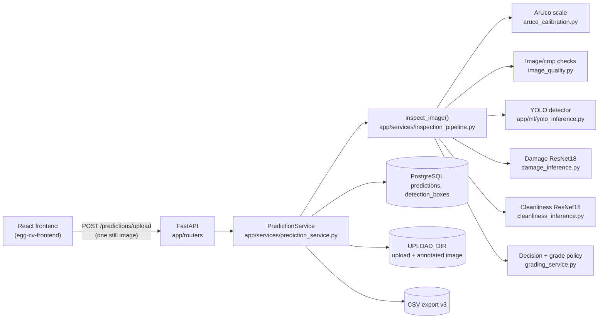
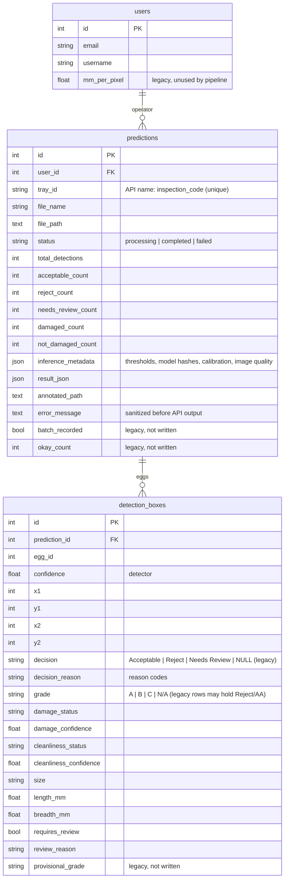

# Architecture, data model, API and configuration

Current as of branch `feat/inspection-quality-decisions` (2026-11-23). Every
statement here maps to a file named in the text; claims about accuracy are
deliberately absent (see `docs/evaluation/`).

## Components

## Inspection workflow (one image)

1. **Upload / capture.** The browser sends one still image (file, sample or
   one captured camera frame; there is no live inference). Size, extension,
   magic bytes and decodability are checked (`file_service.py`).
2. **Calibration.** `detect_scale()` looks for exactly one fully visible
   DICT_4X4_50 marker with the configured ID, checks size, distortion and that
   the detected outline is the marker's black border. Without a valid marker,
   sizes and millimetres are suppressed.
3. **Image checks.** Resolution and sharpness (`assess_image`).
4. **Detection.** YOLO at the request's confidence threshold; coordinates are
   truncated and clipped to the image, degenerate boxes dropped,
   near-duplicates (IoU >= 0.85) removed. Any number of eggs is kept.
5. **Per egg:** crop checks (edge contact, overlap with another egg,
   underexposure, glare), damage classification on a 10%-padded crop,
   cleanliness classification on a tight crop (`app/ml/preprocessing.py`
   mirrors the training transform), then the **decision** and **grade**
   (`grading_service.py`).
6. **Persist** boxes, counts, status and metadata in one transaction; on any
   failure roll back, delete the annotated image and mark the inspection
   `failed`. The CSV export runs after the commit; its failure is recorded,
   not fatal.

## Decision and grade policy

`decision` (first matching rule wins):

| Condition | Decision |
|---|---|
| Any input-reliability reason (low detection confidence, partial or overlapping egg, refused/unusable crop, poor image) | Needs Review |
| Damage = Damaged | Reject |
| Cleanliness = Stained **and** cleanliness release-approved | Reject |
| Damage = Needs Review, or cleanliness Needs Review/Unavailable/Unknown, or cleanliness not release-approved | Needs Review |
| Damage = Not Damaged and approved cleanliness = Clean | Acceptable |

`grade`: `A`/`B`/`C` for Large/Medium/Small only when the decision is
Acceptable, the marker is valid **and** `ARUCO_GRADES_APPROVED=true`;
otherwise `N/A`. With the shipped settings every egg's grade is `N/A` and no
egg can be `Acceptable`.

Reason codes and their UI wording: `app/services/grading_service.py`,
`app/services/image_quality.py`, frontend `src/utils/decisions.ts`.

## Data model

Migration `c3d4e5f6a7b8` adds `decision`, `decision_reason`,
`acceptable_count` and `reject_count`. It drops and rewrites nothing: legacy
rows keep `decision = NULL` and their stored grades; the API maps legacy
`Reject`/`AA` grades to `N/A`/`A` on output.

## API (prefix `/api/v1`)

| Method | Path | Purpose |
|---|---|---|
| POST | `/predictions/upload` (alias `/grade`) | Inspect one image. Query: `confidence_threshold` (0.1–0.99, default 0.75), `save_annotated`. |
| GET | `/predictions` (alias `/records`) | List inspections, newest first. Query: `skip`, `limit`, `decision`, `review_reason`. |
| GET | `/predictions/{id}` | One inspection with every egg. |
| GET | `/predictions/{id}/download` | Annotated image (decision-coloured boxes). |
| DELETE | `/predictions/{id}` | Delete row, eggs, upload and annotated image. |
| GET | `/dashboard/stats` (alias `/stats`) | Totals, decision counts, recent inspections. |
| GET | `/dashboard/decisions` | Egg counts per decision (incl. legacy `undecided`). |
| GET | `/dashboard/grades` | Egg counts per commercial grade. |
| GET | `/dashboard/health` | Readiness, model files + SHA-256, release gates. |
| GET/PUT | `/settings` | Legacy `mm_per_pixel`; not used by the pipeline. |

Removed: `POST /predictions/{id}/record` (multi-image batch recording) and
the response fields `tray_id`, `batch_*`, `okay_count`, `stained_count`,
`provisional_grade`, `max_tray_eggs`, `tray_*`.

## Effective configuration (defaults in `app/config.py`)

| Setting | Value | Note |
|---|---|---|
| `CONFIDENCE_THRESHOLD` / request default | 0.75 | Detector |
| `DAMAGE_DECISION_THRESHOLD` | 0.65 | P(Damaged) >= this -> Damaged |
| `DAMAGE_REVIEW_THRESHOLD` | 0.75 | Not-damaged confidence below this -> Needs Review |
| `CLEANLINESS_DECISION_THRESHOLD` | 0.60 | P(Stained) >= this -> Stained |
| `CLEANLINESS_REVIEW_THRESHOLD` | 0.75 | |
| `CLEANLINESS_RELEASE_APPROVED` | false | Release gate |
| `ARUCO_GRADES_APPROVED` | false | Release gate |
| `ARUCO_MARKER_ID` / `ARUCO_SIDE_MM` | 0 / 50.0 | |
| `DETECTION_CROP_PADDING` / `CLEANLINESS_CROP_PADDING` | 0.10 / 0.0 | Match training crops |
| `DETECTION_DUPLICATE_IOU` | 0.85 | |
| `DETECTION_OVERLAP_REVIEW` | 0.30 | Intersection / smaller box |
| `EDGE_MARGIN_PX` | 2 | |
| `IMAGE_MIN_SIDE_PX` / `IMAGE_MIN_SHARPNESS` | 320 / 5.0 | Heuristic, untuned |
| `CROP_MIN_BRIGHTNESS` / `CROP_MAX_SATURATED_FRACTION` | 35 / 0.25 | Heuristic, untuned |
| `MAX_FILE_SIZE_MB` | 50 | |
| `ACCEPT_UNAUTHENTICATED_ACCESS` | false | Required `true` in production |
| `AUTO_CREATE_SCHEMA` | false | Rejected in production |
| `EGG_CSV_PATH` | `reports/egg_statistics_v3.csv` | New header; old files are never appended to |

No decision threshold was changed in this work. The input-check heuristics
are new; they can only send eggs to review.

## Checkpoints (unchanged; verified by `tests/test_real_models.py`)

| File | SHA-256 |
|---|---|
| `egg_detection/finetune_egg_v1/weights/best.pt` | `c755a7a6cf5ad883486e0396dc0dfda5030ada3007315e6ef479b26a99a931cf` |
| `models/egg_grader_crop_resnet18_v1.pth` | `9fe5d113a5c1c5faebec17b806a09975c50f2cac3cbf67f9a06d5432b26f1861` |
| `models/egg_grader_cleanliness_v1.pth` | `b00884a1f6b03b87e2f8b3378081cbadbbdab9e68218de082d3c624e3c866a6f` |
